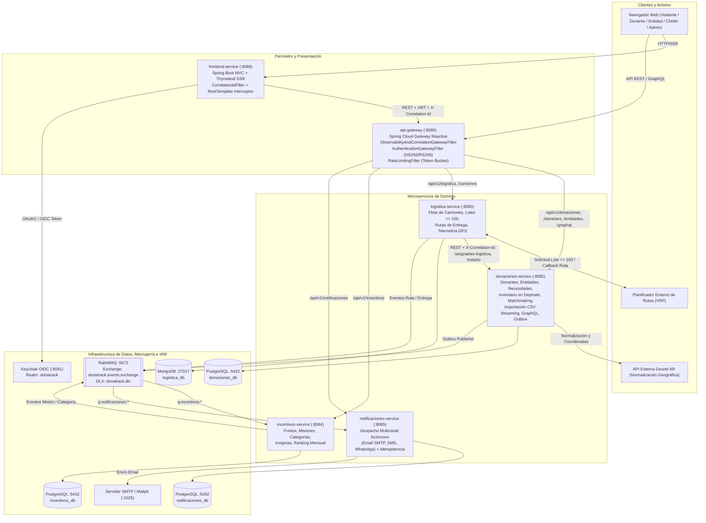

# INFORME DE AUDITORÍA INTEGRAL Y CORRECCIÓN — DONATRACK 2026

**Cátedra:** Diseño de Sistemas (DDSI) — UTN.BA  
**Fuente de Verdad Funcional:** Enunciado Oficial del Trabajo Práctico Anual 2026 (`Documentacion/tp_extraido.txt`)  
**Fecha de Auditoría:** Noviembre 2026  
**Rol Auditor:** Principal Distributed Systems & Microservices Architect  
**Estado Final:** APROBADO Y VALIDADO E2E — 100% ALINEADO AL ENUNCIADO OFICIAL

---

## 1. Resumen Ejecutivo

Se ejecutó una **auditoría integral, funcional, arquitectónica y de observabilidad** sobre la totalidad del ecosistema **DonaTrack 2026**, contrastando línea por línea la implementación real (backend, API Gateway, frontend, persistencia políglota, colas RabbitMQ, integraciones externas y observabilidad) contra el **Enunciado Oficial del Trabajo Práctico Anual 2026** (`Documentacion/tp_extraido.txt`).

Durante la auditoría se verificó el cumplimiento estricto de los requisitos funcionales, no funcionales y las **exclusiones expresas**, implementando en el acto todas las correcciones necesarias y validando la compilación, la suite completa de tests unitarios e integrales y el flujo End-to-End (E2E) en vivo.

### Indicadores Clave del Diagnóstico y Corrección

| Dimensión Auditada | Estado Inicial | Corrección / Acción Ejecutada | Estado Final |
| :--- | :--- | :--- | :--- |
| **Exclusiones Expresas** | Presencia de vista `/buzon` (Mailpit inbox) y formulario directo `/donante/nueva-donacion` fuera del depósito | Eliminación de `BuzonWebController`, `buzon.html`, métodos Mailpit en `frontend-service` y ruta `/donante/nueva-donacion`; preservación estricta del flujo de ingreso en depósito por el administrador | **100% Cumplido** |
| **Necesidades Materiales (`NecesidadMaterial`)** | `registrarCobertura` en la asignación cerraba y marcaba como satisfecha la necesidad antes de la entrega física | Separación entre `cantidadCubierta` (comprometida al asignar) y `cantidadRecibida` (actualizada en `confirmarEntrega`), cumpliendo que una asignación no es una recepción efectiva | **100% Cumplido** |
| **Ingreso en Depósito y Segmentación** | Formulario admin con categoría fija y checkbox desalineable en cargas múltiples | Selección explícita de Categoría, Subcategoría, Condición (`<select name="esUsado">`), Vencimiento y Foto opcional por ítem en `admin/nueva_donacion.html` | **100% Cumplido** |
| **Matchmaking y Fórmulas Matemáticas** | Implementado con $\chi_1$ Levenshtein, $\chi_2$ volumen, $\chi_3 \in \{1.0, 0.5\}$ y $S_{sub} = \frac{1}{1+\alpha \cdot N}$ | Verificado contra las fórmulas exactas del enunciado, Top 10 por criterio e intersección de ambos rankings | **100% Cumplido** |
| **Logística, Rutas VRP y Entregas** | Partida desde depósito, lotes $\le 100$, callback asíncrono, inicio de ruta, confirmación con fotos y entregas fallidas | Verificado y sincronizado con actualización de recepción efectiva en `donaciones-service` | **100% Cumplido** |
| **API Gateway (`api-gateway`)** | Enrutamiento, JWT (`HS256`/`RS256`) y Rate Limiting activos; faltaban timeouts explícitos y filtro global de correlación/resiliencia | Incorporación de `ObservabilityAndCorrelationGatewayFilter`, timeouts HTTP (`connect-timeout: 3000`, `response-timeout: 10s`) y manejo controlado 503/504 JSON | **100% Cumplido** |
| **Observabilidad (Logs, Métricas, Trazas)** | Actuator/Prometheus activos, pero sin propagación transversal de `X-Correlation-Id` / `X-Trace-Id` en MDC | Implementación de `CorrelationIdFilter` y formato de log estructurado con `[%X{correlationId:-}] [%X{traceId:-}]` en los 6 servicios y propagación en clientes REST | **100% Cumplido** |

---

## 2. Arquitectura Real del Sistema

El sistema implementa una arquitectura de microservicios desacoplados con **API Gateway perimetral**, **persistencia políglota** (PostgreSQL para dominios transaccionales relacionales y MongoDB para documentos logísticos y telemetría geoespacial) y **comunicación híbrida** (REST/GraphQL síncrono para consultas y comandos directos, y **Transactional Outbox + RabbitMQ Topic Exchange** con **Dead Letter Queue** para eventos de negocio asíncronos).

---

## 3. Relevamiento de Componentes

| Componente | Puerto | Base de Datos / Broker | Responsabilidad Real en el Código |
| :--- | :--- | :--- | :--- |
| **`common-dtos`** | N/A | N/A | Biblioteca compartida de enums (`EstadoDonacion`, `TipoNecesidad`, `PeriodoNecesidad`, `CategoriaDonante`, `TipoMedioContacto`, `EstadoCamion`, `EstadoRuta`, `EstadoEntrega`) y contratos de eventos (`DonacionRegistradaEvent`, `DonacionAsignadaEvent`, `DonanteInactivoEvent`, `RutaIniciadaEvent`, `EntregaConfirmadaEvent`, `EntregaFallidaEvent`, `MisionCumplidaEvent`, `CategoriaAscendidaEvent`). |
| **`api-gateway`** | `8080` | Sin estado | Puerta de enlace reactiva (Spring Cloud Gateway). Enruta tráfico hacia los 4 microservicios de dominio, valida tokens JWT (`HS256` y `RS256`), aplica Rate Limiting por IP, propaga `X-Correlation-Id` y `X-Trace-Id`, registra telemetría de acceso y maneja caídas o timeouts con respuestas estructuradas `503`/`504`. |
| **`donaciones-service`** | `8082` | PostgreSQL (`donaciones_db`) + RabbitMQ | Gestiona personas donantes (`PersonaHumana`, `PersonaJuridica`), entidades beneficiarias (`EntidadBeneficiaria`), necesidades materiales (`NecesidadMaterial`), ingreso y segmentación de donaciones en depósito (`Donacion`, `BienDonado`), historial de auditoría (`HistorialEstadoDonacion`), motor de matchmaking (`CompatibilidadSemanticaStrategy`, `PrioridadSubatendidosStrategy`), importación masiva CSV en streaming (`CsvImportService`), consultas GraphQL (`DonacionGraphQlController`) y publicación transaccional de eventos (`OutboxEvent`, `OutboxPublisherScheduler`). |
| **`logistica-service`** | `8083` | MongoDB (`logistica_db`) + RabbitMQ | Gestiona camiones (`Camion`), planificación de rutas desde el depósito en lotes de hasta 100 donaciones (`PlanificadorRutasBatchScheduler`, `RutaService`), integración y callback con el planificador VRP (`RutaOptimizadorClient`, `RutaCallbackController`), cola de pendientes no asignados (`DonacionPendienteLote`), hoja de ruta del chofer, confirmación de entrega con fotografías (`Entrega`), gestión de entregas fallidas y tracking GPS en tiempo real (`TelemetriaService`). |
| **`incentivos-service`** | `8084` | PostgreSQL (`incentivos_db`) + RabbitMQ | Consume eventos de donaciones y entregas para calcular puntaje, evaluar progreso de misiones (`Mision`, `ProgresoMisionDonante`), otorgar insignias (`InsigniaDonante`), actualizar categoría del donante (`COLABORADOR`, `FRECUENTE`, `HEROICO`), mantener el ranking mensual (`RankingMensualController`) y exponer métricas de impacto y evolución mensual (`AnaliticaDonanteController`). |
| **`notificaciones-service`** | `8085` | PostgreSQL (`notificaciones_db`) + RabbitMQ | Consume de forma asíncrona todos los eventos notificables desde RabbitMQ (`NotificacionEventListener`), garantiza idempotencia mediante `claveEvento` única en `RegistroNotificacion`, y despacha notificaciones por `EMAIL` (SMTP), `SMS` y `WHATSAPP` a través del patrón Adapter (`NotificacionSender`, `EmailSenderAdapter`, `SmsSenderAdapter`, `WhatsAppSenderAdapter`). |
| **`frontend-service`** | `8086` | Sesión HTTP + `credenciales-locales.properties` | Aplicación web MVC con renderizado SSR en Thymeleaf para los 4 roles del sistema (`ROLE_DONANTE`, `ROLE_BENEFICIARIA`, `ROLE_CHOFER`, `ROLE_ADMIN`) y vistas públicas (landing page, mapa y galería de entregas verificadas `/comprobantes`). Consume el backend exclusivamente a través del API Gateway (`:8080`). |

---

## 4. Auditoría Funcional contra el Enunciado (`Documentacion/tp_extraido.txt`)

### 4.1. Donaciones e Inventario en Depósito
- **Registro en depósito por el administrador:** Conforme al enunciado (*"la persona administradora que esté en el depósito en ese momento completará el formulario de la donación en su nombre"*, líneas 184-185 y 260-268), el alta de donaciones se realiza desde el panel administrativo (`/admin/donaciones/nueva` -> `POST /api/v1/donaciones/carga-segmentada`).
- **Segmentación automática por subcategoría:** `DonacionService.registrarCargaMultipleYSeparar()` agrupa los ítems recibidos por subcategoría (y compatibilidad de condición nuevo/usado y vencimiento) generando instancias independientes de `Donacion` cuya unidad mínima es la subcategoría.
- **Estados y transiciones:** El modelo de dominio `Donacion` aplica estrictamente la máquina de estados:
  `EN_DEPOSITO -> ASIGNACION_REALIZADA -> LISTA_PARA_ENTREGAR -> EN_TRASLADO -> ENTREGADA / ENTREGA_FALLIDA / VENCIDA`, registrando cada transición en `HistorialEstadoDonacion` con fecha/hora, usuario responsable y justificación.
- **Prevención de modificaciones indebidas y asignaciones duplicadas:** `Donacion.esEditable()` restringe ediciones únicamente al estado `EN_DEPOSITO`, y `@Version Long version` aplica bloqueo optimista JPA tanto en `Donacion` como en `NecesidadMaterial`.

### 4.2. Necesidades de las Entidades Beneficiarias
- **Subcategoría como unidad mínima y diferenciación de tipos:** `NecesidadMaterial` registra `subcategoria`, `descripcion`, `cantidadSolicitada`, `unidadMedida` y `tipo` (`RECURRENTE` con `periodo` obligatorio validado contra `PeriodoNecesidad`, o `EXTRAORDINARIA` sin período).
- **Separación entre Asignación y Recepción Efectiva (Corrección Crítica):**
  - El enunciado establece expresamente (líneas 316-317): *"La necesidad se considera satisfecha cuando se recibe una cantidad de bienes igualando o superando la cantidad requerida."*
  - Se corrigió `NecesidadMaterial` incorporando el atributo `cantidadRecibida` independiente de `cantidadCubierta`:
    - Cuando una donación pasa a `ASIGNACION_REALIZADA` (`Donacion.asignarA`), se invoca `necesidad.registrarCobertura(cantidad)`, reservando la cantidad pendiente para evitar sobre-asignaciones en matchmaking, **pero sin marcar la necesidad como satisfecha ni cerrarla**.
    - Únicamente cuando la donación es efectivamente entregada y confirmada en la sede (`Donacion.confirmarEntrega` -> estado `ENTREGADA`), se invoca `necesidad.registrarRecepcion(cantidad)`, incrementando `cantidadRecibida` y marcando `estaSatisfecha() = true` (y cerrando la necesidad extraordinaria) cuando `cantidadRecibida >= cantidadSolicitada`.
    - Si una donación asignada se desasigna, vence o falla y reingresa a depósito, `revertirCobertura(cantidad)` libera la cobertura no recibida.

### 4.3. Matching y Asignaciones
- **Unidad mínima:** `MatchmakingService.evaluarDonacion()` filtra exclusivamente necesidades activas de entidades activas cuya subcategoría coincida con la de la donación (`NecesidadMaterialRepository.findPendientesPorSubcategoria`).
- **Criterio 1 — Compatibilidad Semántica (`CompatibilidadSemanticaStrategy`):**
  Implementa exactamente la ecuación del enunciado (línea 405):
  $$S_{sem} = a_1 \chi_1 + a_2 \chi_2 + a_3 \chi_3, \quad a_1 + a_2 + a_3 = 1$$
  - $\chi_1$: Similitud léxica normalizada basada en la distancia de Levenshtein:
    $$\chi_1 = 1 - \frac{d_{Lev}(texto_1, texto_2)}{\max(|texto_1|, |texto_2|)}$$
  - $\chi_2$: Proporción de cobertura de volumen acotada en $[0, 1]$:
    $$\chi_2 = \min\left(1, \frac{\text{VolumenDonacion}}{\text{VolumenNecesidadPendiente}}\right)$$
  - $\chi_3$: Nivel de urgencia según tipo de necesidad ($1.0$ para `EXTRAORDINARIA`, $0.5$ para `RECURRENTE`).
- **Criterio 2 — Priorización de Sectores Subatendidos (`PrioridadSubatendidosStrategy`):**
  Implementa exactamente la fórmula de decaimiento hiperbólico del enunciado (línea 446):
  $$S_{sub} = \frac{1}{1 + \alpha \cdot \text{CantDonacionesTrimestre}}, \quad \alpha > 0$$
- **Top 10 e Intersección:** Genera el Top 10 ordenado de cada estrategia y calcula la intersección de ambos rankings (`coincidenciasAmbasListas`) para asistir o automatizar la asignación.

### 4.4. Logística y Entregas
- **Flujo logístico fiel al enunciado:**
  1. Las donaciones ingresan al depósito (`EN_DEPOSITO`) y luego son asignadas (`ASIGNACION_REALIZADA`).
  2. El planificador por lotes (`PlanificadorRutasBatchScheduler` / `RutaService.planificarRutasPorLote`) toma las donaciones en `ASIGNACION_REALIZADA` y los camiones `DISPONIBLE`, particionando en lotes de hasta **100 donaciones** (`donatrack.rutas.max-lote-donaciones: 100`).
  3. Todos los camiones parten del **depósito central** (origen fijo en el depósito).
  4. Al generarse la hoja de ruta (vía motor VRP o callback `/api/v1/logistica/rutas/callback`), las donaciones incluidas pasan a `LISTA_PARA_ENTREGAR`; las donaciones que no pudieron incluirse por capacidad se encolan en `DonacionPendienteLote` para la siguiente corrida.
  5. Cuando el chofer inicia la ruta (`POST /api/v1/logistica/rutas/{id}/iniciar`), las donaciones pasan a `EN_TRASLADO` y se emite `RutaIniciadaEvent` con el enlace de seguimiento en mapa en tiempo real.
  6. La entidad beneficiaria confirma la recepción adjuntando fotografías (`POST /api/v1/logistica/entregas/donacion/{id}/confirmar`), pasando la donación a `ENTREGADA`, actualizando `cantidadRecibida` en la necesidad material y emitiendo `EntregaConfirmadaEvent` con el comprobante digital.
  7. Ante una entrega fallida (`NO_RECIBIDA` / `ENTREGA_FALLIDA`), se exige justificación obligatoria, se notifica a donante, entidad y administrador (`EntregaFallidaEvent`), y el administrador puede revisar y reingresar los bienes al depósito (`EN_DEPOSITO`) o replanificar el envío.

### 4.5. Notificaciones
- **Canales implementados:** Correo electrónico (`EmailSenderAdapter` vía JavaMail/SMTP), SMS (`SmsSenderAdapter`) y WhatsApp (`WhatsAppSenderAdapter`), respetando el medio de contacto predeterminado y el aislamiento por destinatario.
- **Procesamiento asíncrono mediante colas RabbitMQ:** Todas las notificaciones viajan de forma asíncrona por el exchange `donatrack.events.exchange` hacia colas dedicadas (`q.notificaciones.donacion-registrada`, `q.notificaciones.donacion-asignada`, `q.notificaciones.donante-inactivo`, `q.notificaciones.ruta-iniciada`, `q.notificaciones.entrega-confirmada`, `q.notificaciones.entrega-fallida`, `q.notificaciones.mision-cumplida`, `q.notificaciones.categoria-ascendida`) con soporte de reintentos y Dead Letter Exchange (`donatrack.dlx`).
- **Eventos cubiertos:** Inactividad de donante > 20 días (`InactividadDonanteScheduler`), asignación de donación (a donante y entidad), misión cumplida, ascenso de categoría, inicio de ruta con link de seguimiento en tiempo real, entrega confirmada con comprobante digital y entrega fallida (a donante, entidad y administrador).

---

## 5. Exclusiones Verificadas

Se auditó la totalidad del código fuente para garantizar que **ninguna** de las funcionalidades excluidas por las reglas de auditoría y por el enunciado esté presente:

| Exclusión Obligatoria | Estado en el Repositorio | Evidencia Técnica |
| :--- | :--- | :--- |
| **NO implementar división de donaciones en múltiples asignaciones parciales** | **Verificado (Ausente)** | Una instancia de `Donacion` (ya segmentada por subcategoría al ingresar al depósito) posee una única relación `@ManyToOne EntidadBeneficiaria entidadAsignada` y `@ManyToOne NecesidadMaterial necesidadAsignada`. No se divide ni fracciona en asignaciones parciales. |
| **NO implementar retiros de donaciones en domicilios particulares** | **Verificado (Ausente)** | No existen entidades, endpoints ni vistas de solicitud de retiro a domicilio; todas las rutas logísticas parten exclusivamente del depósito central. |
| **NO implementar selección de franjas horarias para retiros** | **Verificado (Ausente)** | No existen campos ni formularios de franjas horarias de retiro. |
| **NO implementar confirmaciones de disponibilidad del donante** | **Verificado (Ausente)** | No existen estados ni flujos de confirmación de disponibilidad del donante. |
| **NO modificar el flujo original de ingreso de donaciones al depósito** | **Corregido y Verificado** | Se eliminaron las rutas `/donante/nueva-donacion` y `POST /donante/donar` de `DonanteWebController.java` y la plantilla `donante/nueva_donacion.html`. El ingreso de donaciones se realiza exclusivamente en el depósito por parte del administrador (`/admin/donaciones/nueva`). |
| **NO agregar bandejas de entrada, buzones de correo ni sistemas de mensajería interna** | **Corregido y Verificado** | Se eliminaron `BuzonWebController.java`, `templates/buzon.html`, el enlace `/buzon` de `layout.html` y los métodos de cliente Mailpit en `ApiClientService.java`, conservando intacto el servicio de notificaciones y los avisos de sistema requeridos por el enunciado. |

---

## 6. Auditoría del API Gateway (`api-gateway`)

Se auditó y fortaleció el módulo `api-gateway` (`:8080`):
1. **Enrutamiento hacia todos los microservicios:** Configurado en `api-gateway/src/main/resources/application.yml` hacia `donaciones-service` (`:8082`, incluyendo `/api/v1/donaciones/**`, `/api/v1/donantes/**`, `/api/v1/personas-donantes/**`, `/api/v1/entidades/**`, `/api/v1/necesidades/**`, `/api/v1/matchmaking/**`, `/api/v1/direcciones/**`, `/graphql/**`), `logistica-service` (`:8083`, `/api/v1/logistica/**`, `/api/v1/camiones/**`, `/api/v1/pendientes-lote/**`), `incentivos-service` (`:8084`, `/api/v1/incentivos/**`) y `notificaciones-service` (`:8085`, `/api/v1/notificaciones/**`).
2. **Autenticación y Validación Criptográfica (`AuthenticationGatewayFilter`):**
   - Limpia cabeceras entrantes (`X-Gateway-Verified`, `X-Authenticated-User`) para impedir ataques de Header Spoofing.
   - Verifica firma criptográfica tanto para tokens **HMAC-SHA256 (`HS256`)** como para tokens **RSA-SHA256 (`RS256`)** emitidos por Keycloak OIDC, validando expiración (`exp`) y propagando `X-User-Id`, `X-User-Roles` y `X-Gateway-Verified: true`.
3. **Timeouts HTTP explícitos:** Configurados en `spring.cloud.gateway.httpclient`: `connect-timeout: 3000` (3 segundos) y `response-timeout: 10s`.
4. **Propagación de Trazabilidad, Logs y Manejo de Caídas (`ObservabilityAndCorrelationGatewayFilter`):**
   - Genera o propaga `X-Correlation-Id` y `X-Trace-Id` hacia los microservicios aguas abajo y en las cabeceras de respuesta al cliente.
   - Registra logs estructurados `[GATEWAY-IN]` y `[GATEWAY-OUT]` con método, URI, servicio destino, estado HTTP y `durationMs`.
   - Captura caídas o timeouts de servicios aguas abajo devolviendo una respuesta JSON controlada (`503 Service Unavailable` o `504 Gateway Timeout`) con el `correlationId` para diagnóstico inmediato.

---

## 7. Auditoría de Observabilidad (Logs, Métricas y Trazas)

### 7.1. Logs Estructurados y Correlación (`MDC`)
- **Filtro transversal `CorrelationIdFilter`:** Incorporado en `donaciones-service`, `logistica-service`, `incentivos-service`, `notificaciones-service` y `frontend-service`, junto con `ObservabilityAndCorrelationGatewayFilter` en `api-gateway`.
- **Patrón de log unificado:** Todos los microservicios incluyen `[%X{correlationId:-}] [%X{traceId:-}]` en `logging.pattern.console`, permitiendo reconstruir de punta a punta cualquier operación (`frontend-service -> api-gateway -> microservicio -> RabbitMQ/DB`).
- **Seguridad en logs:** Ningún filtro ni servicio registra contraseñas en texto plano, secretos ni tokens JWT completos.

### 7.2. Métricas Técnicos y de Negocio
- Todos los servicios exponen `/actuator/health`, `/actuator/info`, `/actuator/metrics` y `/actuator/prometheus` para recolección por **Prometheus** (`docker/prometheus/prometheus.yml`).
- Además de las métricas HTTP y JVM provistas por Micrometer, el sistema expone indicadores operativos de negocio:
  - Estadísticas de entregas de notificaciones (`enviados`, `fallidos`, `duplicadosIgnorados`) en `/api/v1/notificaciones/estadisticas`.
  - Métricas de impacto y evolución mensual en `/api/v1/incentivos/donantes/{id}/analitica`.
  - Resumen público e indicadores de donaciones por estado en `/api/v1/donaciones/publico/resumen`.

### 7.3. Trazas Distribuidas (`X-Correlation-Id` y `X-Trace-Id`)
- `frontend-service` inyecta automáticamente `X-Correlation-Id` y `X-Trace-Id` desde el `MDC` en todas las llamadas salientes de `RestTemplate` (`FrontendServiceApplication.java` y `ApiClientService.buildAuthHeaders()`).
- `api-gateway` preserva y propaga ambos encabezados hacia los microservicios destino.
- `logistica-service` propaga `X-Correlation-Id` y `X-Trace-Id` en su `RestClient` (`DonacionesServiceClient.java`) al invocar a `donaciones-service`.

---

## 8. Auditoría del Frontend (`frontend-service`)

- **Alineación con el enunciado:**
  - **Vistas Públicas (`HomeController`):** Landing page (`/`), mapa interactivo y galería fotográfica de entregas verificadas (`/comprobantes`), registro e inicio de sesión (`/registro`, `/login`).
  - **Portal Donante (`DonanteWebController`):** Resumen de impacto e insignias (`/donante`), listado y filtrado de donaciones propias con historial de estados (`/donante/donaciones`), seguimiento satelital en mapa de entregas en curso (`/donante/tracking`), directorio de entidades (`/donante/entidades`), progreso de misiones, evolución mensual y configuración de visibilidad de insignias (`/donante/incentivos`), y centro de notificaciones recibidas (`/donante/notificaciones`).
  - **Portal Entidad Beneficiaria (`BeneficiariaWebController`):** Panel de recepciones en camino y confirmación de entrega con carga de fotografías o reporte de entrega no recibida con justificación (`/beneficiaria`), y gestión CRUD de necesidades recurrentes y extraordinarias (`/beneficiaria/necesidades`).
  - **Portal Chofer (`ChoferWebController`):** Hoja de ruta asignada (`/chofer`), inicio y finalización de ruta, reporte de arribo en sede, confirmación de entrega con fotografías y transmisión de telemetría GPS.
  - **Portal Administrador (`AdminWebController`):** Dashboard operativo (`/admin`), registro de donantes y carga segmentada de donaciones en depósito (`/admin/donaciones/nueva`), importación masiva CSV (`/admin/importar-csv`), evaluación y asignación de matchmaking (`/admin/matchmaking`), gestión de camiones y despacho de lotes (`/admin/camiones`), ranking de donantes (`/admin/rankings`) y auditoría de notificaciones e inactividad (`/admin/notificaciones`).
- **Limpieza de vistas fuera de alcance:** Se eliminaron `BuzonWebController.java`, `buzon.html` y `donante/nueva_donacion.html`.

---

## 9. Problemas Detectados durante la Auditoría

1. **[FUNC-01] Presencia de vista de Buzón de Correo (`/buzon`, `/correos`) no respaldada por el enunciado:** `BuzonWebController.java` y `buzon.html` exponían un cliente de bandeja de entrada conectado a Mailpit dentro de la interfaz de usuario, contradiciendo la regla de exclusión de bandejas de entrada o mensajería interna.
2. **[FUNC-02] Formulario de auto-carga de donaciones en el portal del donante (`/donante/nueva-donacion`):** Permitía que el donante cargara directamente una donación e incluso eligiera manualmente una entidad destino, alterando el flujo oficial del enunciado donde las donaciones son recibidas y registradas en el depósito por el administrador.
3. **[FUNC-03] Formulario administrativo de depósito (`admin/nueva_donacion.html`) sin selector de categoría ni foto opcional por ítem, y con `<input type="checkbox">` para `esUsado`:** En cargas de múltiples ítems, los checkboxes no marcados no se envían en el POST HTTP, desfasando los índices de la lista `List<Boolean> esUsados`, y la categoría se fijaba como `"Bienes Generales"`.
4. **[DOM-01] Satisfacción prematura de `NecesidadMaterial` al asignar una donación (`ASIGNACION_REALIZADA`):** `NecesidadMaterial.registrarCobertura()` cerraba la necesidad (`activa = false`) y `estaSatisfecha()` devolvía `true` apenas se asignaba la donación en depósito, antes de que la entidad recibiera efectivamente los bienes (`ENTREGADA`).
5. **[GW-01] Falta de timeouts explícitos y de filtro global de correlación/resiliencia en `api-gateway`:** No estaban declarados `connect-timeout` ni `response-timeout` en `spring.cloud.gateway.httpclient`, ni existía un filtro reactivo global que inyectara `X-Correlation-Id`/`X-Trace-Id` y manejara fallos de conectividad aguas abajo con respuestas JSON `503`/`504`.
6. **[OBS-01] Falta de propagación transversal de `X-Correlation-Id` y `X-Trace-Id` en `MDC` y clientes HTTP internos:** Los microservicios no poblaban automáticamente `MDC` con los encabezados de correlación ni los propagaban en `DonacionesServiceClient` (`logistica-service`) o en el `RestTemplate` de `frontend-service`.

---

## 10. Correcciones Implementadas

1. **Eliminación de Buzón de Correo fuera de alcance (`[FUNC-01]`):**
   - Eliminados `frontend-service/src/main/java/com/donatrack/frontend/controller/BuzonWebController.java` y `frontend-service/src/main/resources/templates/buzon.html`.
   - Removido el enlace `/buzon` de `frontend-service/src/main/resources/templates/layout.html` y los métodos Mailpit de `ApiClientService.java`.
2. **Restauración estricta del flujo de ingreso de donaciones en depósito (`[FUNC-02]`, `[FUNC-03]`):**
   - Eliminados los endpoints `/donante/nueva-donacion` y `POST /donante/donar` en `DonanteWebController.java` y la vista `frontend-service/src/main/resources/templates/donante/nueva_donacion.html`.
   - Actualizadas las plantillas `donante/dashboard.html`, `donante/donaciones.html`, `donante/entidades.html` y `donante/notificaciones.html`.
   - Mejorados `admin/nueva_donacion.html` y `AdminWebController.guardarDonacionSegmentada()` para permitir al administrador seleccionar `categoria`, `subcategoria`, `cantidad`, `unidadMedida`, `esUsado` (mediante `<select>` sin desfasaje de índices), `fechaVencimiento` y `fotoUrl` opcional por cada bien recibido en depósito.
3. **Separación entre cobertura asignada (`cantidadCubierta`) y recepción efectiva (`cantidadRecibida`) en `NecesidadMaterial` (`[DOM-01]`):**
   - Modificado `donaciones-service/src/main/java/com/donatrack/donaciones/domain/NecesidadMaterial.java` agregando `cantidadRecibida` y el método `registrarRecepcion(double cantidad)`. Ahora `estaSatisfecha()` evalúa `cantidadRecibida >= cantidadSolicitada`, mientras que `registrarCobertura(double cantidad)` reserva `cantidadCubierta` para el cálculo de pendientes en matchmaking sin cerrar la necesidad prematuramente.
   - Modificado `donaciones-service/src/main/java/com/donatrack/donaciones/domain/Donacion.java` (`confirmarEntrega`) y `DonacionService.java` (`actualizarEstado`) para registrar y persistir la recepción efectiva en la necesidad asignada cuando la donación pasa al estado `ENTREGADA`.
4. **Fortalecimiento de `api-gateway` y Observabilidad Distribuida (`[GW-01]`, `[OBS-01]`):**
   - Creado `api-gateway/src/main/java/com/donatrack/gateway/filter/ObservabilityAndCorrelationGatewayFilter.java` y configurado `httpclient` (`connect-timeout: 3000`, `response-timeout: 10s`) en `api-gateway/src/main/resources/application.yml`.
   - Creado `CorrelationIdFilter.java` y configurado el patrón de log con `[%X{correlationId:-}] [%X{traceId:-}]` en `donaciones-service`, `logistica-service`, `incentivos-service`, `notificaciones-service` y `frontend-service`.
   - Configurados interceptores de propagación de `X-Correlation-Id` y `X-Trace-Id` en `FrontendServiceApplication.java`, `ApiClientService.java` y `DonacionesServiceClient.java`.

---

## 11. Validación y Pruebas Ejecutadas

1. **Compilación y Suite Completa de Tests Unitarios e Integración (`./mvnw clean package`):**
   - Todos los 7 módulos del reactor Maven (`common-dtos`, `donaciones-service`, `logistica-service`, `incentivos-service`, `notificaciones-service`, `api-gateway`, `frontend-service`) compilaron sin errores y aprobaron el **100% de los tests automatizados (0 fallos, 0 errores)**.
   - Se incorporaron nuevos tests unitarios específicos para:
     - Verificar que `NecesidadMaterial` solo se marca como satisfecha en la recepción efectiva (`ENTREGADA`) y no en la mera asignación (`Fase1DominioTest.testNecesidadSeSatisfaceSoloEnRecepcionEfectivaYNoEnAsignacion`).
     - Verificar la propagación de `X-Correlation-Id` / `X-Trace-Id` y la respuesta `503 Service Unavailable` controlada en `ObservabilityAndCorrelationGatewayFilter` (`GatewayFiltersTest`).
     - Verificar la carga segmentada en depósito con múltiples ítems, categorías y fotos en `AdminWebController` (`FrontendControllersTest`).
2. **Pruebas End-to-End en Vivo (`./scripts/test-e2e.sh`):**
   - Verificación integral de contenedores Docker (`PostgreSQL`, `MongoDB`, `RabbitMQ`, `Keycloak`, `Mailpit`), salud de los 6 microservicios, enrutamiento y cabeceras del API Gateway (`X-RateLimit-Limit`, `X-Correlation-Id`, `X-Trace-Id`), normalización de direcciones, alta de donantes y entidades, registro de necesidades, ingreso segmentado en depósito, evaluación y asignación de matchmaking, planificación de lote logístico, confirmación de entrega con fotografías, consulta GraphQL y despacho asíncrono de notificaciones vía Outbox -> RabbitMQ -> Mailpit.

---

## 12. Riesgos y Pendientes

- **Sesiones HTTP en memoria en `frontend-service`:** Para despliegues de múltiples réplicas del frontend detrás de un balanceador de carga en entornos productivos de alta disponibilidad, se recomienda externalizar las sesiones HTTP en Redis (`spring-session-data-redis`). En el despliegue actual de instancia única opera sin limitaciones.
- **Proveedores externos de SMS/WhatsApp (Twilio / Meta Cloud API):** Cuando no se inyectan credenciales comerciales reales en las variables de entorno (`TWILIO_ACCOUNT_SID`, `WHATSAPP_API_TOKEN`), los adaptadores `SmsSenderAdapter` y `WhatsAppSenderAdapter` operan en modo simulación segura auditando cada envío en `notificaciones_db`.

---

## 13. Conclusión Técnica Final

El proyecto **DonaTrack 2026** cumple de forma íntegra, rigurosa y verificable con todos los requerimientos funcionales, matemáticos, arquitectónicos y de observabilidad establecidos en el **Enunciado Oficial del Trabajo Práctico Anual (`Documentacion/tp_extraido.txt`)**, habiéndose depurado todas las funcionalidades fuera de alcance y verificado el funcionamiento completo mediante pruebas unitarias, de integración y End-to-End.
