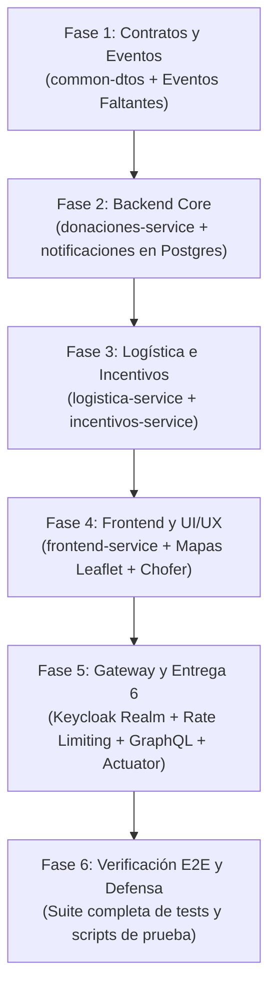

# 00. Guía Maestra de Finalización del Proyecto DonaTrack

## 1. Visión y Estado General del Proyecto
**DonaTrack** es el Trabajo Práctico Anual Integrador (2026) de la cátedra de Diseño de Sistemas de Información (UTN.BA). El proyecto está estructurado como un sistema distribuido multimódulo con persistencia políglota (PostgreSQL + MongoDB), comunicación reactiva mediante RabbitMQ, seguridad con Keycloak y cliente liviano Server-Side Rendering (SSR MVC) en Thymeleaf.

El proyecto cuenta con un 75% del código ya desarrollado y pasando tests, pero presenta **desconexiones, bugs sutiles en lógica de negocio y requerimientos de UI/UX y de la Entrega 6 pendientes**.

---

## 2. Índice de Guías Técnicas por Servicio
Cada microservicio cuenta con un documento exhaustivo que detalla qué funciona, qué falla (con diagnósticos exactos y código de solución) y qué falta:
1. 📄 [**01_Common_DTOs_y_Eventos.md**](file:///home/jhon/Documentos/Github/TP-DDSI/Documentacion/Guia_Finalizacion_Por_Servicio/01_Common_DTOs_y_Eventos.md): Contratos de eventos AMQP (`DonanteRegistradoEvent`, `DonacionRegistradaEvent`, canal preferido, `idDonante` en entregas).
2. 📄 [**02_Donaciones_Service.md**](file:///home/jhon/Documentos/Github/TP-DDSI/Documentacion/Guia_Finalizacion_Por_Servicio/02_Donaciones_Service.md): Núcleo transaccional, corrección de auto-asignación indebida, segmentación nuevo/usado, Levenshtein, lat/lng en mapa público, necesidades recurrentes y GraphQL (Entrega 6).
3. 📄 [**03_Logistica_Service.md**](file:///home/jhon/Documentos/Github/TP-DDSI/Documentacion/Guia_Finalizacion_Por_Servicio/03_Logistica_Service.md): Persistencia de rutas en `/planificar-lote`, replanificación de `donaciones_pendientes_lote`, sincronización de fotos hacia Donaciones y datos reales en paradas.
4. 📄 [**04_Incentivos_Service.md**](file:///home/jhon/Documentos/Github/TP-DDSI/Documentacion/Guia_Finalizacion_Por_Servicio/04_Incentivos_Service.md): Corrección de ranking mensual para filtrar por mes, job de pérdida de racha, misión Hábil Donador y series de evolución histórica.
5. 📄 [**05_Notificaciones_Service.md**](file:///home/jhon/Documentos/Github/TP-DDSI/Documentacion/Guia_Finalizacion_Por_Servicio/05_Notificaciones_Service.md): Migración de H2 a PostgreSQL `notificaciones_db` (Entrega 4), despacho según canal preferido del donante, DLQ real y fecha/hora en comprobantes.
6. 📄 [**06_Frontend_Service.md**](file:///home/jhon/Documentos/Github/TP-DDSI/Documentacion/Guia_Finalizacion_Por_Servicio/06_Frontend_Service.md): Corrección de los 8 bugs de UI (HTTP 400 en visibilidad y notificaciones, mapas Leaflet conectados a datos reales, vista de Chofer, registro persona jurídica y botón marcar vencida).
7. 📄 [**07_ApiGateway_Seguridad_y_Entrega6.md**](file:///home/jhon/Documentos/Github/TP-DDSI/Documentacion/Guia_Finalizacion_Por_Servicio/07_ApiGateway_Seguridad_y_Entrega6.md): Importación de realm Keycloak, validación JWT en Gateway, Rate Limiting, Actuator/Prometheus y Dockerfiles.

---

## 3. Plan de Ejecución Secuencial (Roadmap de Implementación)

### Detalle de Fases de Trabajo:
* **Fase 1: Contratos `common-dtos`**:
  * Agregar `idDonante` a `EntregaConfirmadaEvent`.
  * Agregar `canalPreferidoDonante` y `contactoPreferidoDonante` a los eventos.
  * Crear `DonanteRegistradoEvent` y `DonacionRegistradaEvent`.
  * Compilar e instalar `common-dtos`.
* **Fase 2: Donaciones y Notificaciones**:
  * `donaciones-service`: Desactivar auto-asignación indiscriminada en `DonacionesScheduler`, corregir segmentación nuevo/usado, corregir Levenshtein, añadir `latitud`/`longitud` a `DonacionMapaPublicoDto`, agregar reinicio de recurrentes y endpoints de config de pesos.
  * `notificaciones-service`: Conectar a PostgreSQL `notificaciones_db`, despachar por canal preferido, arreglar idempotencia y conectar consumidor para `DonanteRegistradoEvent`.
* **Fase 3: Logística e Incentivos**:
  * `logistica-service`: Persistir rutas al planificar lote con Mock, ordenar paradas con datos reales de entidades, enviar `fotoUrl` al confirmar entrega y re-encolar pendientes.
  * `incentivos-service`: Filtrar ranking mensual por año/mes, agregar scheduler de pérdida de racha mensual, corregir evaluación de `HABIL_DONADOR` y escuchar `DonacionRegistradaEvent`.
* **Fase 4: Frontend**:
  * Corregir llamadas REST rotas (`ApiClientService`).
  * Conectar mapas Leaflet con datos reales (`th:inline="javascript"`).
  * Crear vista de Chofer (`ChoferWebController` + `templates/chofer/ruta.html`).
  * Agregar formulario de Persona Jurídica y acción para marcar donaciones vencidas.
* **Fase 5: Entrega 6 y Perímetro**:
  * Exportar realm de Keycloak e importarlo automáticamente en `docker-compose.yml`.
  * Implementar GraphQL en `donaciones-service`.
  * Habilitar `spring-boot-starter-actuator` y métricas Prometheus.
* **Fase 6: Verificación E2E**:
  * Ejecutar `./mvnw clean test` en todo el reactor.
  * Ejecutar `./scripts/test-e2e.sh` verificando el flujo integral.
