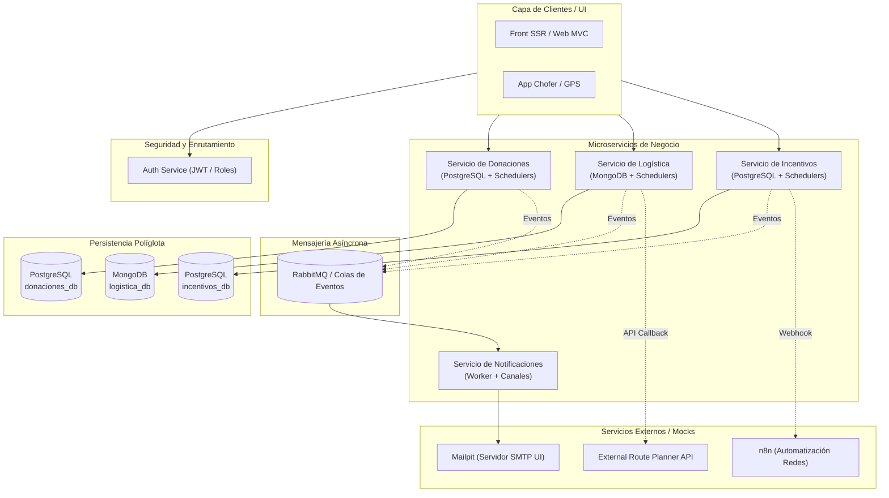

# Plan de Arquitectura y Definición de Microservicios: DonaTrack

Definición arquitectónica y estructura de proyecto multimódulo desacoplado para el Trabajo Práctico Anual de Diseño de Sistemas de Información (UTN - DDSI 2026): **DonaTrack**.

---

## 1. Visión General de la Arquitectura

El sistema se compone de servicios autónomos, desacoplados y altamente cohesivos. Cada servicio cuenta con su propio ciclo de vida, persistencia independiente (relacional o documental según los lineamientos de la cátedra), tareas programadas (cronjobs) y contratos de integración claros.



---

## 2. Definición Detallada de Microservicios

### 2.1. Servicio de Donaciones (`donaciones-service`)
* **Responsabilidad de Negocio**:
  * Gestión y registro de Donantes (personas humanas y jurídicas, representantes, medios de contacto).
  * Gestión de Entidades Beneficiarias y sus Necesidades (recurrentes y extraordinarias).
  * Carga y segmentación automática de donaciones por subcategoría (unidad mínima de asignación).
  * Auditoría y máquina de estados de donaciones (`EN_DEPOSITO`, `ASIGNACION_REALIZADA`, `LISTA_PARA_ENTREGAR`, `EN_TRASLADO`, `ENTREGADA`, `ENTREGA_FALLIDA`, `VENCIDA`).
  * Algoritmos de Matchmaking extensibles (Strategy): Compatibilidad Semántica (Levenshtein, volumen, urgencia) y Prioridad a sub-atendidos.
  * Importador por lotes masivo de Donantes vía CSV (>10.000 / 20.000 filas).
* **Persistencia**: Base de datos Relacional (**PostgreSQL**, base `donaciones_db`).
* **Cronjobs / Tareas Calendarizadas**:
  * Ejecución batch de algoritmos de Matchmaking en horarios de baja carga (ej. 02:00 AM).
  * Verificación periódica de caducidad de bienes perecederos en depósito.
  * Detección de inactividad de donantes (>20 días sin interacción) para emitir eventos de reactivación.
* **Integración y Eventos**:
  * Publica eventos en RabbitMQ: `donacion.asignada`, `donante.inactivo`.
  * Endpoint requerido de Entrega 1: `GET /api/v1/saludo` -> `"Hola desde el servicio de Donaciones."`.

---

### 2.2. Servicio de Logística (`logistica-service`)
* **Responsabilidad de Negocio**:
  * Gestión de flota de camiones (patente, capacidad m³, altura m, capacidad peso kg).
  * Planificación y trazabilidad de rutas y entregas.
  * Integración con planificador externo de rutas en lotes de hasta 100 donaciones con URL de callback.
  * Monitoreo en tiempo real de posición satelital / app móvil del chofer.
  * Confirmación de entrega por parte de la entidad beneficiaria con soporte para subida de fotos.
* **Persistencia**: Base de datos Documental (**MongoDB**, base `logistica_db`), requerido explícitamente en el TP para modelar documentos flexibles de rutas geográficas y waypoints.
* **Cronjobs / Tareas Calendarizadas**:
  * Disparo nocturno de solicitudes de optimización de rutas al proveedor externo para la jornada siguiente.
  * Reintento de donaciones no asignadas o fallidas.
* **Integración y Eventos**:
  * Publica eventos en RabbitMQ: `ruta.iniciada`, `entrega.completada`, `entrega.fallida`.

---

### 2.3. Servicio de Incentivos (`incentivos-service`)
* **Responsabilidad de Negocio**:
  * Consolidación y analítica de datos de donaciones (totales históricos, evolución por períodos).
  * Sistema de Gamificación: Categorías de donante (*Colaborador*, *Sostenedor*, *Transformador*).
  * Gestión de Misiones secuenciales (*Racha*, *Completitud*, *Hábil Donador*, *Donaciones Exitosas*) y otorgamiento de Insignias.
  * Generación y persistencia de rankings mensuales de donantes más activos.
* **Persistencia**: Base de datos Relacional (**PostgreSQL**, base `incentivos_db`).
* **Cronjobs / Tareas Calendarizadas**:
  * Cierre mensual: cálculo y persistencia del ranking mensual de donantes activos a fin de mes.
  * Verificación mensual de corte para reset de misiones sensibles al tiempo (ej. racha mensual).
* **Integración y Eventos**:
  * Consume eventos de donaciones y entregas para actualizar progreso de misiones.
  * Dispara webhook hacia servicio de automatización (ej. n8n / bot) para difusión de insignias en redes sociales.
  * Publica eventos en RabbitMQ: `mision.cumplida`, `categoria.ascendida`.

---

### 2.4. Servicio de Notificaciones (`notificaciones-service`)
* **Responsabilidad de Negocio**:
  * Despacho multicanal de notificaciones: Correo electrónico, SMS, WhatsApp.
  * Gestión de plantillas, historial de envíos y estados (pendiente, enviado, error).
  * En Entrega 1: simulación / logging.
  * En Entregas posteriores: consumo asíncrono desde colas RabbitMQ y despacho real vía SMTP y APIs externas.
* **Persistencia**: Base de datos Relacional (**PostgreSQL**, base `notificaciones_db` o embebida).
* **Integración**:
  * Consumer de RabbitMQ escuchando tópicos de todos los servicios.
  * Conexión SMTP a contenedor **Mailpit** para inspección visual de correos en entorno de desarrollo.

---

### 2.5. Servicio de Autenticación (`auth-service`)
* **Responsabilidad de Negocio**:
  * Registro de usuarios y credenciales (Donante, Entidad Beneficiaria, Administrador).
  * Generación y firma de tokens JWT (Stateless).
  * Verificación de permisos y roles en endpoints protegidos.
* **Persistencia**: Base de datos Relacional (**PostgreSQL**, base `auth_db`).

---

## 3. Entorno de Ejecución e Infraestructura Docker

Toda la infraestructura de soporte se definirá en un archivo `docker-compose.yml` unificado para levantar el stack con un solo comando (`docker-compose up -d`):

| Servicio Contenedor | Imagen | Puerto Host | Propósito |
| :--- | :--- | :--- | :--- |
| **`postgres`** | `postgres:16-alpine` | `5432:5432` | Motores relacionales (crea bases `donaciones_db`, `incentivos_db`, `auth_db`) |
| **`mongo`** | `mongo:7.0` | `27017:27017` | Motor NoSQL documental para `logistica-service` |
| **`rabbitmq`** | `rabbitmq:3-management` | `5672:5672`, `15672:15672` | Broker AMQP + UI de administración en puerto 15672 |
| **`mailpit`** | `axllent/mailpit` | `1025:1025` (SMTP), `8025:8025` (UI) | Servidor de correo de desarrollo con interfaz web local |

---

## 4. Estructura de Proyecto Propuesta (Multimódulo Maven)

Para cumplir con el requerimiento expreso del enunciado (*"El sistema deberá implementarse como una aplicación multimódulo"*), se estructurará un proyecto raíz Maven con submódulos desacoplados:

```text
TP-DDSI/
├── docker/
│   ├── docker-compose.yml
│   └── init-scripts/
│       └── 01-init-databases.sql
├── pom.xml                               # POM padre multimódulo (dependencias comunes y gestión de versiones)
├── donaciones-service/
│   ├── pom.xml
│   └── src/
│       └── main/
│           ├── java/com/donatrack/donaciones/
│           │   ├── domain/              # Modelos ricos de dominio (Donante, Donacion, Bien, Entidad, Necesidad)
│           │   ├── matchmaking/         # Estrategias de Matchmaking (Levenshtein, Subatendidos)
│           │   ├── csv/                 # Importador de CSV masivo
│           │   ├── scheduler/           # Cronjobs (Spring @Scheduled)
│           │   ├── controller/          # Endpoints REST (incluye saludo inicial de Entrega 1)
│           │   └── ...
│           └── resources/
│               └── application.yml
├── logistica-service/
│   ├── pom.xml
│   └── src/
│       └── main/
│           ├── java/com/donatrack/logistica/
│           │   ├── domain/              # Camion, Ruta, Parada, Entrega
│           │   ├── tracking/            # Procesamiento de GPS
│           │   ├── external/            # Cliente de integración con optimizador externo
│           │   └── ...
│           └── resources/
│               └── application.yml
├── incentivos-service/
│   ├── pom.xml
│   └── src/
│       └── main/
│           ├── java/com/donatrack/incentivos/
│           │   ├── domain/              # Mision, Insignia, Categoria, Ranking
│           │   ├── analytics/           # Métricas de donantes
│           │   └── ...
│           └── resources/
│               └── application.yml
├── notificaciones-service/
│   ├── pom.xml
│   └── src/
│       └── main/
│           ├── java/com/donatrack/notificaciones/
│           │   ├── domain/              # CanalNotificacion, Mensaje, Historial
│           │   ├── sender/              # Implementaciones (Email, WhatsApp, SMS simulados)
│           │   └── consumer/            # Consumidores RabbitMQ
│           └── resources/
│               └── application.yml
├── auth-service/
│   ├── pom.xml
│   └── src/
│       └── main/
│           ├── java/com/donatrack/auth/
│           │   └── ...
│           └── resources/
│               └── application.yml
├── common-dtos/                          # Opcional: DTOs y eventos compartidos (RabbitMQ payloads)
│   ├── pom.xml
│   └── src/
├── Diagramas/
│   ├── Dominio.puml
│   └── Arquitectura.puml
└── Documentacion/
```

---

## 5. Decisiones de Diseño Clave

> [!IMPORTANT]
> **Alineación con el Programa de la Cátedra**:
> 1. **Entrega 1**: Foco en modelado de objetos rico (evitar modelos anémicos), patrones de diseño (Strategy para matchmaking, State para ciclo de vida de donación, Observer/Publisher para eventos), importación CSV eficiente con streaming, y exposición del endpoint REST de prueba en Donaciones.
> 2. **Persistencia Políglota**: PostgreSQL para modelos relacionales fuertemente estructurados y MongoDB para logística (rutas y coordenadas dinámicas).
> 3. **Independencia de Servicios**: Cada microservicio puede ejecutarse de manera aislada con su propia configuración de base de datos y puertos asignados.

---

## 6. Plan de Verificación

### Pruebas Automatizadas
- Tests unitarios JUnit 5 para las entidades y lógica de dominio de cada módulo.
- Pruebas del algoritmo de asignación / matchmaking con casos de prueba conocidos.
- Prueba de lectura del archivo CSV de donantes con streaming de memoria.

### Verificación Manual / Infraestructura
1. Ejecución de `docker-compose up -d` para verificar que levanten PostgreSQL, MongoDB, RabbitMQ y Mailpit sin conflictos de puertos.
2. Compilación del proyecto multimódulo con Maven Wrapper (`./mvnw clean compile`).
3. Ejecución de `donaciones-service` y verificación del endpoint `GET /api/v1/saludo` retornando `"Hola desde el servicio de Donaciones."`.
4. Acceso a las consolas de gestión:
   - RabbitMQ Management: `http://localhost:15672`
   - Mailpit Web UI: `http://localhost:8025`
