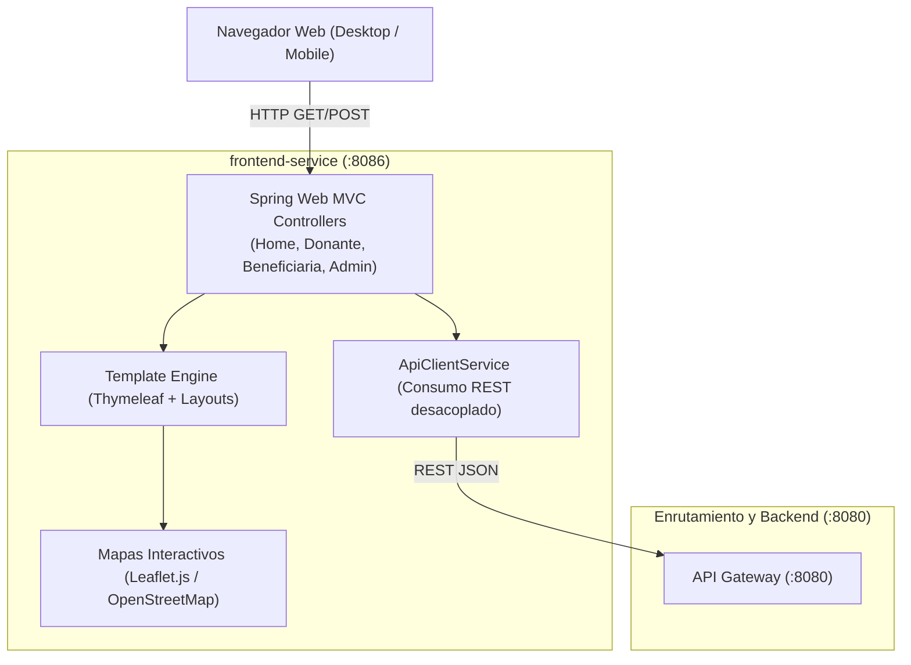

# Plan de Implementación: Módulo Frontend SSR / Web MVC (`frontend-service`) - Entregas 4 y 5

Para completar las **Entregas 4 y 5** según las especificaciones del TP Anual de Diseño de Sistemas de Información (UTN.BA), implementaremos un **Cliente Liviano Desacoplado** basado en Server-Side Rendering (Spring Boot + Thymeleaf), consumiendo de forma transparente las APIs del ecosistema a través del API Gateway (`:8080`).

---

## 1. Alcance y Arquitectura del Frontend Desacoplado



---

## 2. Requerimientos de UI/UX a Implementar

1. **Landing Page Pública (Sin Login)**:
   - Presentación institucional de DonaTrack y UTN Solidaria.
   - Indicadores globales de impacto (kilos donados, donaciones activas, comedores alcanzados).
   - Mapa interactivo de donaciones ya entregadas con marcadores interactivos.
   - Galería de fotos y comprobantes de recepción sin necesidad de login.
   - Enlaces de navegación rápida y términos de privacidad.

2. **Portal del Donante**:
   - Resumen de actividad personal y donaciones realizadas.
   - Filtros dinámicos por estado (`EN_DEPOSITO`, `EN_TRASLADO`, `ENTREGADA`, etc.) y por subcategoría de bienes.
   - **Panel de Incentivos y Gamificación**: Nivel de donante (`COLABORADOR`, `SOSTENEDOR`, `TRANSFORMADOR`), barra de progreso de misiones activas y vitrina de insignias desbloqueadas.
   - **Seguimiento Logístico en Mapa**: Visualización satelital en tiempo real de los camiones asignados al reparto de sus donaciones.
   - Directorio de Entidades Beneficiarias para conocer comedores y hogares asistidos.

3. **Portal de Entidad Beneficiaria**:
   - Formulario ágil para registrar **Necesidades Materiales** (subcategoría, cantidad, unidad de medida, urgencia `EXTRAORDINARIA` o `RECURRENTE`).
   - Gestión de donaciones asignadas pendientes de recepción.
   - Pantalla de **Confirmación de Recepción** con carga de fotografías y generación de comprobante.
   - Mapa de tracking en tiempo real del camión que se aproxima con la entrega.

4. **Portal del Administrador**:
   - Gestión y alta de camiones de la flota logística (patente, capacidad m³, peso kg).
   - Panel de **Matchmaking Inteligente**: visualización de puntuaciones semánticas (Levenshtein, volumen, urgencia) y subatendidos, con botón de confirmación de asignación.
   - Pantalla de **Importación Masiva de Donantes (CSV >20.000 filas)** con reporte en tiempo real de filas creadas, actualizadas y errores.
   - Tabla y visualización del **Ranking Mensual** de donantes más activos.
   - Formulario de alta y segmentación automática de donaciones en depósito.

---

## Proposed Changes

### Raíz del Proyecto

#### [MODIFY] [pom.xml](file:///home/jhon/Documentos/Github/TP-DDSI/pom.xml)
- Registrar `<module>frontend-service</module>` en la lista de módulos de Maven.

---

### Nuevo Módulo: `frontend-service`

#### [NEW] [frontend-service/pom.xml](file:///home/jhon/Documentos/Github/TP-DDSI/frontend-service/pom.xml)
- Configuración con `spring-boot-starter-web`, `spring-boot-starter-thymeleaf`, `spring-boot-starter-validation`, `spring-boot-starter-test`.

#### [NEW] [frontend-service/.../FrontendServiceApplication.java](file:///home/jhon/Documentos/Github/TP-DDSI/frontend-service/src/main/java/com/donatrack/frontend/FrontendServiceApplication.java)
- Clase de arranque Spring Boot en puerto `8086`.

#### [NEW] [frontend-service/.../ApiClientService.java](file:///home/jhon/Documentos/Github/TP-DDSI/frontend-service/src/main/java/com/donatrack/frontend/service/ApiClientService.java)
- Cliente HTTP REST resiliente configurado hacia `http://localhost:8080` (API Gateway) para abstraer el consumo de Donaciones, Logística e Incentivos.

#### [NEW] Controladores Web MVC
- [HomeController.java](file:///home/jhon/Documentos/Github/TP-DDSI/frontend-service/src/main/java/com/donatrack/frontend/controller/HomeController.java): Landing pública, mapa de entregas, galería de comprobantes.
- [DonanteWebController.java](file:///home/jhon/Documentos/Github/TP-DDSI/frontend-service/src/main/java/com/donatrack/frontend/controller/DonanteWebController.java): Mis donaciones, panel de gamificación, tracking GPS y entidades.
- [BeneficiariaWebController.java](file:///home/jhon/Documentos/Github/TP-DDSI/frontend-service/src/main/java/com/donatrack/frontend/controller/BeneficiariaWebController.java): Carga de necesidades, donaciones asignadas, confirmación con fotos.
- [AdminWebController.java](file:///home/jhon/Documentos/Github/TP-DDSI/frontend-service/src/main/java/com/donatrack/frontend/controller/AdminWebController.java): Camiones, matchmaking, carga segmentada, importación CSV y rankings.

#### [NEW] Vistas Thymeleaf (`src/main/resources/templates/`)
- `layout.html`: Plantilla base responsive con navbar, footer, estilos y CDN de Leaflet.js.
- `index.html`: Landing page principal interactiva.
- `comprobantes.html`: Galería pública de fotos y comprobantes.
- `donante/`: `dashboard.html`, `donaciones.html`, `incentivos.html`, `tracking.html`.
- `beneficiaria/`: `dashboard.html`, `necesidades.html`, `confirmar.html`.
- `admin/`: `dashboard.html`, `camiones.html`, `matchmaking.html`, `importar_csv.html`, `rankings.html`.

#### [NEW] Pruebas Unitarias
- [FrontendControllersTest.java](file:///home/jhon/Documentos/Github/TP-DDSI/frontend-service/src/test/java/com/donatrack/frontend/FrontendControllersTest.java): Pruebas MockMvc para las rutas de frontend.

---

### Scripts de Automatización

#### [MODIFY] [scripts/services-up.sh](file:///home/jhon/Documentos/Github/TP-DDSI/scripts/services-up.sh)
- Añadir el arranque de `frontend-service` en background (:8086).

#### [MODIFY] [scripts/services-down.sh](file:///home/jhon/Documentos/Github/TP-DDSI/scripts/services-down.sh)
- Detener limpiamente el proceso de `frontend-service`.

---

## Verification Plan

### Automated Tests
1. Compilar y ejecutar pruebas de todo el proyecto:
   ```bash
   ./mvnw clean test
   ```
2. Verificar que el nuevo módulo `frontend-service` compila y sus pruebas MockMvc pasan al 100%.

### Verificación Visual / Navegación
1. Acceder a `http://localhost:8086/` para verificar la Landing Page y el mapa de donaciones entregadas.
2. Navegar a los portales:
   - `/donante`: verificar visualización de donaciones, insignias y tracking GPS.
   - `/beneficiaria`: probar formulario de necesidades y confirmación de entrega con fotos.
   - `/admin`: verificar tablas de camiones, rankings y panel de matchmaking.
